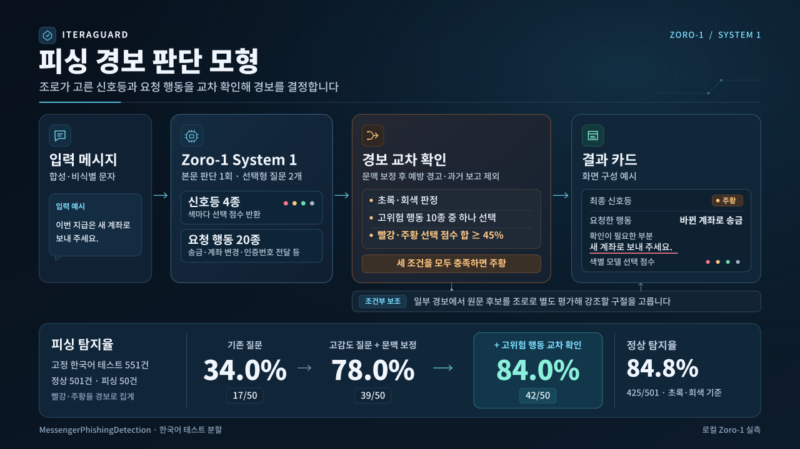

# 의심계 · IteraGuard

**[▶ 웹 시연 바로가기](https://iteraguard.frameddormouse32.chatgpt.site/)**

의심스러운 문자나 이메일을 붙여넣으면 **피싱 신호등, 상대가 요구한 행동, 다시 읽어볼 원문 구절**을 한 화면에서 확인할 수 있습니다. 회계 요청에는 어떤 절차로 확인할지도 함께 안내합니다.

## Zoro-1을 어떻게 활용했나요?

의심계는 Zoro-1의 **PointerHead**로 등급과 행동을 판단하고, 원문 구절을 비교하고, 상황에 맞는 확인 절차를 찾습니다. [Zoro-1 모델 설명](https://huggingface.co/trillionlabs/Zoro-1)

| 기술 | 실제 작동 방식 |
| --- | --- |
| **한 요청에서 신호등과 행동을 따로 선택** | 같은 원문을 두 질문에 넣습니다. 조로는 **신호등 4색** 중 하나와 **요청 행동 20개** 중 하나를 각각 고릅니다. 그래서 같은 주황이라도 송금을 요구하는지, 링크를 열라는 건지 구분해 보여줄 수 있습니다. |
| **두 답을 교차 확인** | 초록·회색이더라도 조로가 고위험 행동을 골랐고 빨강·주황 선택 점수의 합이 45% 이상이면 주황으로 표시합니다. 행동이 불명확하면 초록을 회색으로 보류합니다. 화면의 점수 막대에는 조로의 원래 선택 점수를 표시합니다. |
| **확인이 필요한 원문에 형광펜** | 빨강·주황 결과에서는 요청이 담긴 구절을 후보로 뽑아 조로에게 따로 보여줍니다. 조로가 경보를 준 후보 중 점수가 가장 높은 한 구절을 골라, 결과 카드에 **원문 그대로 인용하고 색으로 강조**합니다. |
| **조로로 회계 확인 절차 검색** | 회계 요청이면 조로에게 **로컬 JSON의 확인 절차 14종과 ‘해당 없음’**을 후보로 줍니다. 조로가 고른 절차 ID로 앱이 등록된 확인 단계와 문서 번호를 불러옵니다. 이 조회는 별도 벡터 DB 서버 없이 작동합니다. |

### 같은 계좌 이야기라도 다음 행동은 다릅니다

- **“등록된 은행 계좌를 결제 전에 다시 확인해 주세요.”** → **FIN-01 · 은행 계좌정보 재확인**. 사내에 등록된 계좌와 예금주를 대조합니다.
- **“기존 계좌 대신 새 계좌로 오늘 송금해 주세요.”** → **FIN-02 · 새 계좌 송금 전 이중 확인**. 지급을 보류하고 기존 거래처 연락처로 확인한 뒤 별도 승인을 받도록 안내합니다.

[회계 확인 절차 목록](configs/accounting_procedures.json)

### PointerHead를 검색 엔진으로 쓰는 구조

키워드 검색은 단어가 일치하는 항목을 찾고, 벡터 검색은 임베딩의 유사도로 후보를 고릅니다. 의심계는 **조로의 PointerHead 자체를 검색 엔진으로 활용**합니다. 사례와 매뉴얼의 ID와 짧은 설명을 선택지로 주면, 조로가 메시지의 맥락을 읽고 후보별로 점수를 매깁니다. 앱은 조로가 고른 ID로 로컬 JSON에서 실제 사건 요약과 공식 출처, 또는 매뉴얼의 대응 절차를 불러옵니다.

이 구조에서는 원문 하나에 세 질문을 묶어 **위험도 판정 + 유사한 실제 피해 사례 검색 + 사내 대응 매뉴얼 검색**의 결과를 한 번의 Zoro 요청에서 함께 받을 수 있습니다. 별도 키워드 검색기나 벡터 DB 서버 없이 **조로 모델 하나와 로컬 JSON**으로 구성할 수 있습니다.

현재 웹 시연에는 **회계 확인 절차 조회**가 적용되어 있습니다. 세 질문을 묶는 방식은 별도 로컬 실험에서 확인했습니다. 새 계좌 송금 합성 요청 한 건에 대해 조로가 **빨강·유사 사례 후보 AT01·회계 절차 FIN-02**를 함께 골랐습니다. [확장 구조와 실험 범위](#확장-아이디어--pointerhead를-검색-엔진으로-활용)

### 실측 결과

고정 한국어 테스트 551건에서 피싱 경보는 **17/50건(34%) → 42/50건(84%)**으로 늘었습니다. 같은 표본의 정상 문자 경보는 **46/501건 → 76/501건**이었습니다. [실측 환경과 채점 기준](docs/SIGNAL_BENCHMARK_UI_20261120.md)

## 연구모형

현재 소스는 **v5.9**, Arena 엔진은 **v5.6**, Zoro 응답 계약은 **v5.1**입니다. [버전 정보](LATEST_VERSION.json)



## 현재 시연에서 할 수 있는 일

| 화면 | 기능 |
| --- | --- |
| **문자 신호등** `/` | 합성·비식별 메시지를 넣으면 **빨강·주황·초록·회색** 등급, **요청한 행동**, 네 색의 Zoro 선택 점수를 보여줍니다. 가능한 경우 **확인이 필요한 원문 한 구절**을 강조합니다. |
| **성능검증** `/` | 고정 한국어 테스트 551건의 집계와 색별 분포를 보여줍니다. 원본 CSV와 로컬 Zoro를 연결하면 화면에서 재측정할 수 있습니다. |
| **상세 Arena** `/arena` | 상황에 따라 중단·독립 확인·추가 질문을 안내합니다. 새 위험을 확인 업무로 저장하고, 다음 입력이 평범해도 이전 미해결 업무를 유지합니다. |
| **링크 확인** `/link-review` | 별도 화면에서 설정된 조회 자료를 확인할 수 있습니다. 조회 결과가 있을 때 사용자가 선택하면 로컬 Zoro가 메시지와 조회 결과를 함께 읽습니다. |

기본 `high-recall` 프로필은 고위험 행동 10종을 교차 확인합니다. 확인된 예방 경고와 과거 보고는 이 교차 확인에서 제외합니다. 회계 카드의 등록 계좌는 가상 예시입니다.

상세 Arena는 Zoro의 후보 선택과 예·아니오 응답을 현재 문장의 근거와 함께 읽고 조치를 정합니다. [Arena 시연과 검증 범위](docs/V56_ARENA_DEMO_UPDATE.md) · [에이전트 실행 로그 A·B·C](docs/execution-logs/2026-11-20/README.md)

### 확장 아이디어 · PointerHead를 검색 엔진으로 활용

Zoro-1의 **PointerHead를 로컬 목록을 조회하는 검색기(신경망 인덱스)**로 활용합니다. 문자 원문 하나에 아래 세 질문을 묶어 보내면, 하나의 Zoro 요청에서 위험도와 검색 결과를 함께 받을 수 있습니다.

| 질문 | Zoro가 선택하는 값 | 앱이 보여주는 내용 |
| --- | --- | --- |
| 위험도 판정 | 신호등 네 색 중 하나 | 현재 문장의 위험도 |
| 공개 피해·피싱 사례 검색 | 원문과 유도 수법이 비슷한 사례 ID 또는 보류 | 저장된 요약과 공개 출처 |
| 사내 대응 매뉴얼 검색 | 현재 요청에 적용되는 절차 ID 또는 보류 | 확인 단계와 참조 문서 |

앱은 사례와 매뉴얼을 로컬 JSON에 저장합니다. 요청 시 각 질문에 후보의 ID와 짧은 설명을 넣고, Zoro가 고른 ID로 저장된 상세 정보를 읽습니다. **별도 DB 서버나 벡터 검색 서비스 없이 Zoro 모델 하나**로 이 조회를 구성할 수 있습니다. 로컬 엔진의 상한은 질문당 255개 선택지이며, 필요한 경우 그 안에 보류 선택지도 포함합니다.

현재 의심계는 [회계 확인 절차](configs/accounting_procedures.json) 조회를 붙인 상태입니다. 공개 사례 검색은 별도 로컬 실험에서 살폈으며, 세 질문을 한 요청에 묶는 방식은 확장 구상입니다. 로컬 합성 요청 한 건에서 세 응답을 함께 받았습니다. 새 계좌 송금 요청에 대해 빨강, 공개 사례 후보 AT01, 회계 절차 FIN-02에 해당하는 ID가 선택됐습니다.

## 피싱 탐지율 실측

같은 한국어 테스트 551건에서 **피싱 탐지율이 34.0% → 84.0%**로 올랐습니다. 피싱 탐지율은 피싱으로 라벨된 50건 중 빨강·주황 경보가 나온 비율입니다.

| 적용 조건 | 피싱 탐지율 | 정상 탐지율 |
| --- | ---: | ---: |
| 이전 기본 질문 | 34.0% (17/50) | 90.8% (455/501) |
| 고감도 질문과 문맥 보정 | 78.0% (39/50) | 88.2% (442/501) |
| **현재 기본값** · 고감도 질문과 고위험 행동 교차 확인 | **84.0% (42/50)** | **84.8% (425/501)** |

**정상 탐지율**은 정상 501건 중 경보가 없었던 비율로 초록 325건과 회색 100건을 셉니다. 피싱을 25건 더 탐지했고 정상 문자에 뜬 경보는 46건에서 76건으로 늘었습니다. 최종 이진 정확도는 **84.8% (467/551)**, 정상의 초록만 정답으로 세는 엄격 일치율은 **66.6% (367/551)**입니다.

로컬 Zoro-1 `bf1b76b9`, CUDA BF16, 온도 **1.59**로 Arena 재측정 API에서 **551회 요청**을 실행해 최종 집계를 재현했습니다. 소요 시간은 **209.446초**였습니다. 질문과 규칙을 검토한 고정 표본의 결과입니다. 새 표본에서의 탐지 성능과 원문 구절 표시 정확도는 미검증입니다. [실측 환경과 채점 기준](docs/SIGNAL_BENCHMARK_UI_20261120.md)

### 평가 데이터 출처와 이용 조건

고려대학교 Autonomous AI Lab의 `MessengerPhishingDetection`에서 제공하는 **한국어 테스트 분할**을 사용했습니다. 이 실험에서는 551건을 로컬 모델의 평가 입력으로 사용했습니다.

| 항목 | 평가 기준 |
| --- | --- |
| 원본 파일 | `messenger_phishing_dataset/kor/test.csv` |
| 원본 리비전 | `438cfbb251410fee791f49d75d928520847030c3` |
| 라벨 | `0` 정상 501건, `1` 피싱 50건 |
| CSV SHA-256 | `31bed1a63581de43b1c81b84c8714873199ace1f92a4d93830478842df5443bf` |

[고려대 Autonomous AI Lab](https://github.com/ku-autoai) · [고정 리비전 데이터 설명](https://github.com/ku-autoai/MessengerPhishingDetection/blob/438cfbb251410fee791f49d75d928520847030c3/README.md) · [고정 CSV](https://github.com/ku-autoai/MessengerPhishingDetection/blob/438cfbb251410fee791f49d75d928520847030c3/messenger_phishing_dataset/kor/test.csv)

고정 리비전의 문서와 데이터 디렉터리에서 CSV의 라이선스 및 재배포 조건을 확인하지 못했습니다. 이 저장소에는 출처 링크, 해시와 실측 집계를 실었습니다. CSV를 다시 배포하거나 다른 용도로 이용할 때는 원 게시처에 적용 조건을 확인하세요. [외부 자료 고지](THIRD_PARTY_NOTICES.md)

## 로컬에서 실행하기

Python 3.12와 로컬 Zoro-1 System 1 서버를 준비합니다. 모델 가중치와 서빙 환경은 별도로 설치합니다. 실행 전에 `DMSG_SYSTEMONE_ENDPOINT`를 사용 중인 Zoro 서버의 `/v1/systemone` 엔드포인트로 설정합니다. `.env.example`의 값은 셸에서 직접 설정해야 적용됩니다.

```bash
export DMSG_MODEL_ENABLED=1
export DMSG_SYSTEMONE_ENDPOINT
export DMSG_MODEL_ID=trillionlabs/Zoro-1
export DMSG_SEND_MODEL_FIELD=1
export DMSG_REQUIRE_MODEL_ECHO=1
export DMSG_MODEL_TIMEOUT_S=20
python -X utf8 -m arena.server --port 8769
```

Windows PowerShell에서는 같은 변수를 `$env:DMSG_MODEL_ENABLED = "1"` 형식으로 설정하고 `./run_hackathon.ps1 -Port 8769`를 실행할 수 있습니다. 서버 연결과 응답 형식은 실제 판단 요청에서 확인합니다.

실행 후 터미널에 출력된 주소를 브라우저에서 엽니다. 합성·비식별 문자를 입력하고 **판단하기**를 누릅니다. 확인 업무와 이력은 `/arena` 경로에서 확인할 수 있습니다.

### 551건 재측정하기

위 고정 리비전에서 원본 `test.csv`를 내려받아 모델 환경을 설정한 셸에서 실행합니다. 재측정 서버는 사용 전에 CSV의 SHA-256과 라벨 구성을 검증합니다.

```bash
python -X utf8 -m arena.server --port 8769 --signal-benchmark-csv /path/to/test.csv
```

메인 화면에서 **성능검증 → 재측정 시작**을 누르면 진행 건수를 볼 수 있습니다. 551건을 마치면 네 색의 건수와 지표를 갱신합니다. 이전 기본 질문을 비교할 때는 `--signal-profile baseline`을 지정합니다.

## 검증과 참고 문서

**트랙 1 실행 로그 3종**은 실제 로컬 Zoro로 검증했습니다. A와 B는 소스 `62c0acf`에서 실행했고, C는 `778eed8`에 복구 안내를 수정해 브라우저에서 다시 실행했습니다. [A · 인증번호 요구와 경고](docs/execution-logs/2026-11-20/A_credential_request.json) · [B · 송금 위험과 업무 유지](docs/execution-logs/2026-11-20/B_retained_payment_risk.json) · [C · 연결 실패 후 복구](docs/execution-logs/2026-11-20/C_transport_failure_recovery_ui.json) · [실행 조건과 읽는 법](docs/execution-logs/2026-11-20/README.md)

```bash
python -X utf8 -m unittest discover -s tests_v56 -v
python -X utf8 -m unittest discover -s tests_v54 -v
node --test tests_demo_validation/test_api_ui.js tests_v50/test_session_ui.js tests_v53/test_choice_ui.js
python -X utf8 tools/run_judge_scenarios.py --mode controlled --out runs/controlled
python -X utf8 tools/run_judge_scenarios.py --mode live --out runs/live
```

`controlled`는 고정 응답으로 앱의 동작을 검증합니다. `live`는 설정된 로컬 모델 서버에 요청합니다. 상세 Arena의 `GET /api/evidence?session_id=...`는 요청·정책·업무 이력을 공개 증거 형식으로 제공합니다.

- **상세 기능과 규칙** · [Arena v5.6](docs/V56_ARENA_DEMO_UPDATE.md) · [신호등 질문 비교](docs/SIGNAL_PAIRED_EVALUATION_KO.md) · [심사 증거 안내](docs/JUDGE_EVIDENCE_GUIDE.md)
- **산업별 확인 절차** · 별도 Rulebook은 계좌 변경과 환불 템플릿에 대해 확인 업무를 제안합니다. [구성 및 로컬 실행법](docs/V58_RULEBOOK_ARCHITECTURE.md)
- **추가 연구 자료** · [경고 문맥 관찰](docs/V58_RULE_TWEAK_SHADOW_REVIEW.md) · [사기 유형의 합성 사례](docs/research/SCAM_EVIDENCE_ATLAS_2026_KO.md) · [선택형 Jev 관찰](docs/V58_JEV_CLOUD_TEXT_STUDIO.md)
- **이력** · [현재 프로젝트 상태](CURRENT_PROJECT_STATE.md) · [인계 기록](HANDOFF_CHANGELOG.md) · [버전 장부](internal/VERSION_LEDGER.md) · [v5.9 초기 UI·처리 시간 검토](docs/V59_ARENA_UI_AND_PERFORMANCE.md)

이 저장소의 시연 범위는 합성·비식별 입력에 대한 판단과 확인 안내입니다. 실제 송금, 결제 승인, 계좌 변경은 담당자의 별도 확인이 필요한 업무입니다. Zoro 선택 점수는 주어진 보기 사이의 상대 점수입니다.

## 라이선스

- **IteraGuard 원저작물**은 [Apache-2.0](LICENSE)입니다. [라이선스 적용 범위](LICENSE_SCOPE.md)
- **Zoro-1 가중치**는 Apache-2.0입니다. Hugging Face에서 모델 파일을 받으려면 해당 저장소의 접근 조건에 동의해야 합니다. 모델은 실행 환경에서 별도로 준비합니다. [Zoro-1 모델 카드](https://huggingface.co/trillionlabs/Zoro-1#license) · [실측 리비전의 LICENSE](https://huggingface.co/trillionlabs/Zoro-1/resolve/bf1b76b9b4df03b05fcbb73444e1cd4db0f566da/LICENSE)
- **외부 데이터와 이전 APK·ZIP 등**은 자료별 조건을 따릅니다. [외부 자료 고지](THIRD_PARTY_NOTICES.md)
