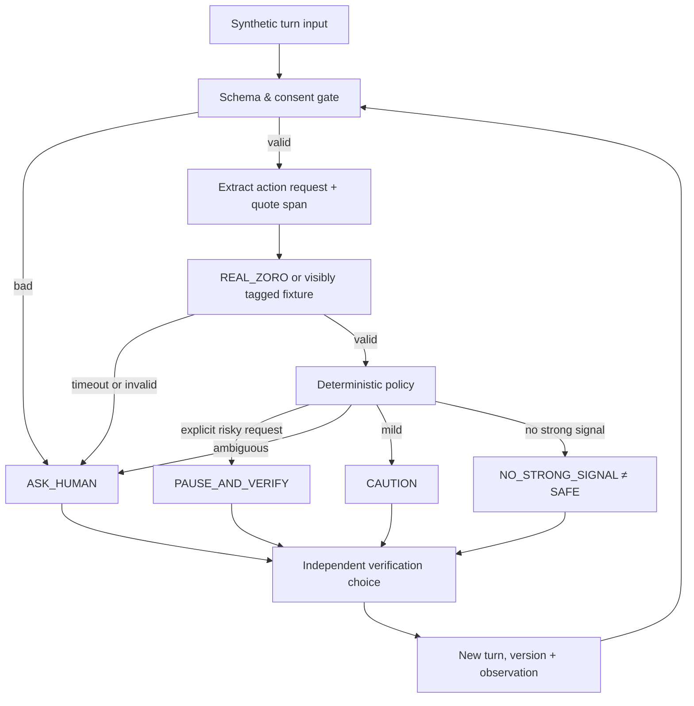

# Elenchus, SNM, 4D Ontology, and reverse-trace test

## Three Socratic-style lines (NOT authentic quotations)

- 더 많은 센서가 생겼다는 사실이 더 안전한 판단을 증명하지는 않는다.
- 모델이 그럴듯하게 말한 수치를 실측 결과로 부르기 전에 출처를 물어라.
- 멈춤을 권할 권한과 돈을 실제로 동결할 권한은 전혀 다르다.

## Single recurring unfounded assumption

> **"모델의 확률·수식·온톨로지로 장식한 판단은 현실의 안전성과 행동 권한을 함께 제공한다."**

**Counterexample:** A normal bank employee explains legitimate account maintenance; the surrogate's `TOKEN_LOGIT_WEIGHTS` outputs 0.97 for 'fraud' and the UI freezes a fake account for 10 minutes. Has the model proven a scam or actually protected funds? **No.** The number was not produced by a verified model or validated as a real-world posterior, and a visual freeze is not a bank transaction. No real safety effect was measured. Misleading claims would be a product defect.

## 12 challenge questions

1. Is the allegedly live score from the real checkpoint, or a token table?
2. Is a caller claiming to be the police equivalent to independently confirmed police identity?
3. What is the counterexample of a legitimate remote setup request?
4. If a model is uncertain, is a longer chain of thought necessarily better?
5. Why would all 8 questions trigger expensive reasoning when only one affects user safety?
6. Is a correct explanation supported by a source span or only model prose?
7. Did you calculate ECE on real Korean scam-call labels, or quote another benchmark?
8. If speech recognition uses network processing, can the demo be called entirely offline?
9. Who legally can freeze a bank transfer? Does a browser mock have that authority?
10. Can a 23-hour three-person hackathon ship three production domains responsibly?
11. Does a successful local unit-test suite imply that real Zoro inference and deepfake detection work?
12. Is a high-recall detector useful if it falsely reassures or blocks normal essential activity?

## SNM state network

Policy cannot automatically freeze transfer, send real message, end call, or infer identity; these are **not edges** in the graph.

## 4D ontology

| Dimension | Entities/events | Falsification test |
|---|---|---|
| Structure | CallerClaim, Turn, ActionRequest, EvidenceSpan, Decision, PolicyAction, Mode | ClaimedIdentity != VerifiedIdentity; source span valid |
| Time | T0 original turn, T1 extraction, T2 inference, T3 policy, T4 user choice, T5 new observation | no late response overwrites new turn; log version |
| Perspectives | person receiving call, protected family member, security engineer, judge, bank/regulator | explanation understandable, human agency respected, no unilateral finance action |
| Direction/validation | forward input→action and reverse action→rule→span→original turn | every action has a valid reason and test |

The ontology is the **typed relation and constraint model**, not a claim that the language model's weights use an explicit knowledge graph. SNM is a scenario transition map, not empirical proof of success.

## Traceability example

`R04 (identity role distinction)` → input schema (`claimed_identity`) → decision question (`identity_claimed`) → `policy.py` does not escalate for that field alone → `test_claimed_authority_alone_not_risk` → `NO_STRONG_SIGNAL` UI with non-assurance wording. Reverse checking from UI should recover the exact test and input sample.

## PAYLOCK 재검증 경계

의심계에 PAYLOCK을 더했다고 지급사기 예방 효과가 증명되는 것은 아니다. 모델이 비정형 메일에서 계좌 변경을 포착하더라도 `등록 거래처 계좌 자체가 오염된 경우`와 `발신 메일함이 탈취된 경우`는 남는다. 구조적 등록 원장과 외부 이메일 주장을 분리하고, 결과 상태에서 마스터 일치/불일치, 불변 정책, 오프라인 확인의 자기 보고 여부를 역추적한다. 단일 프로세스 모형은 실제 지급과 2인 인증을 하지 않는다. NPU 실행 여부는 모델·하드웨어 실증 전까지 NOT_VERIFIED.
