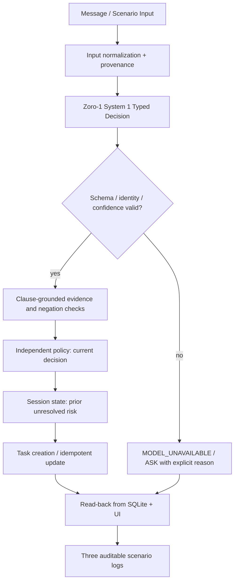

# TRILLION AGENT AI HACKATHON 2026 — Track 1 공식 자료·검수 증거·심사 대응 통합 전략

**프로젝트:** IteraGuard / 의심계 · Zoro-1 Arena · Track 1  
**작성·검토일:** 2026-11-19(KST)  
**산출물 성격:** 행사 지침의 정밀 해석 + v5.3 근거 감사 + **v5.4 개발 실행 명세(미구현)** + 제출·발표 체크리스트  
**Source of Truth:** `Trillion_Hackathon_2026_안내자료.pdf`(주최 측 공식, 23쪽) > 사용자가 제공한 현장 녹취 > 각 버전 실제 소스/로그 > 사용자 제공 제3자 검수 > 공개 연구 참고 > 분석자의 조건부 권고.

> **중요:** v5.4를 구현하거나 실제 Zoro·Android·GitHub·Google Slides에서 새 테스트를 통과했다고 주장하지 않는다. 이 문서는 **손호성 님이 준비 중인 v5.4를 위한 요구사항·반례·합격 조건**이며, 소스/가중치/Drive는 쓰기 변경하지 않았다. 우승·무결성·실세계 사기예방을 보장하지 않는다.

## Executive Decision (1분 요약)

**판단:** 최신 확인된 Drive 폴더는 v5.3이며, 핵심 판단 엔진은 v5.1 계약을 유지한다. v5.4에서는 Zoro 자체 재학습이나 Jev 결합보다 먼저 **(1) 실제 Zoro 진입점 단일화, (2) 새로운 ASK의 확인업무 누락 수정, (3) OTP 동의어·화행 구간 근거 처리, (4) 모델 API 계약 고정, (5) 3종 End-to-End 로그와 오류 복구**를 해결해야 한다.

**핵심 메시지:** “의심계는 Zoro-1으로 위험 행동 요청을 분해해 확인업무를 만들고, 이후 말이 바뀌어도 미해결 위험을 잊지 않는 의사결정 에이전트다.”

**최종 제출에 필요한 것:** 주최 측 **Google Slides 원본 템플릿**, 정제한 Apache-2.0 GitHub 저장소(심사위원 접근), 3가지 실행 로그, 실제 접근 가능한 데모 URL/QR. **11월 20일 오전 9시** 마감.

---

## 1. 23쪽 공식 PDF 전수 목차 및 조치 연결

| 페이지 | 공식 자료에서 확인한 사실 | 실무 조치/비해당 구분 |
|---|---|---|
| 1 | 대회 표지 | 브랜드/행사명 사용; 주최 로고는 사용 범위 확인 |
| 2 | 기존 코드 사용 허용, 코드 공개 허용/**Apache-2.0**, 배려 | 새 코드는 라이선스 조건 검토, 비밀키·외부 저작물 공개 금지 |
| 3 | Track1 100점 / 50+50, **System 1 Zoro-1 필수** | Zoro 실호출 증거 없으면 Track1 핵심 요건 미충족 위험 |
| 4 | 창의성 50 = 실제 적용 가능성·사업화; 완성도는 15 목표/15 오류/15 라이브/5 발표 | 모든 데모와 슬라이드를 공식 배점에 매핑 |
| 5–6 | Track2 GravityOCR 최적화·품질·속도 평가 | **Track1에 부적용**. Track2의 '모델 가중치·추론 스택 전체 수정' 허용이 Track1에서도 자동 허용된다는 뜻 아님 |
| 7 | Track1 GPU 크레딧 **팀당 $100**, L40S 권장, 종료일 당일까지 사용 | L40S 1개 검증 환경, 비용/종료 시점 별도 점검 |
| 8 | NVIDIA Brev 팀장 링크 초대, 팀원 SSH/Jupyter 권한 | 별도 계정·키, 역할별 최소권한; 공유 토큰 공개 금지 |
| 9 | 발표자료 **주최 제공 Google Slides 템플릿 필수**, PPTX/PDF 제출 불가, 파일명 `발표순서_트랙_팀명` | `NN_T1_팀명` 형태로 Slides 원본 제목 지정, 두 자리 순번 확인 |
| 10 | 발표자료 지정 Drive 폴더에 제출 | 실제 QR/폴더·편집 권한 확인; 지정 폴더 외 임의 업로드 금지 |
| 11 | Track1 GitHub 저장소 + **실행 로그 3종** + 데모 URL/QR, 심사위원 3인 GitHub ID | `usik-luke-trl`, `guks-trl`, `hongjoonahn-trl`; 저장소 접근 검증 |
| 12 | Track2 제출 방식 | Track1 제출과 혼동 금지 |
| 13 | Google Drive Slides, 저장소·로그3·데모, 링크 권한/심사위원 초대 최종 확인 | 실제 참가자/심사위원 시점의 접근 가능 여부 읽기 검증 |
| 14 | 현장 운영·개발 문의 경로 | 모델/규칙의 애매한 허용 범위는 현장 연구진에게 질의 |
| 15 | Day1 11/19 오프닝·개발·저녁·야식 | 라이브 테스트/개발과 발표 리허설 분리 |
| 16 | Day2 11/20 08:00 재집합, **09:00 제출**, 09:30~12:00 발표·심사 | 08:00 이전 코드 동결 권장, 제출 상태 read-back |
| 17 | 해킹·질문·음식·휴식·사진 구역 | Q&A Zone에서 Zoro/가중치 변경 허용 범위 물어보기 |
| 18–19 | 식사·휴식 | 운영 일정 참고, 필수 개발 요건은 아님 |
| 20 | 현장 Wi-Fi·전원 이용 수칙 | 공식 Wi-Fi 패스워드 등 행사 접근 정보는 공개 GitHub/보고서에 복제하지 않음 |
| 21–22 | 참가·안전·응급 | 공개 코드·운영 안전은 각자 별도 준수 |
| 23 | 표지/종료 화면 | 적용 사항 없음 |

**출처 충돌 처리:** 기존 팀 매뉴얼이 발표 자료를 PDF/PPTX로 제출할 수 있는 것처럼 설명했다면, **공식 PDF 9쪽의 Google Slides 필수**를 우선한다. 과거 홍보 페이지의 모집 규모와 오늘 현장 참석 팀 수가 다르더라도 대회 현장 규정은 이번 공식 자료와 녹취가 직접적인 근거다. 공식 PDF가 명시한 Apache-2.0도 모델·타사 파일 전체에 자동 적용되는 권리 확보를 뜻하지 않는다.

## 2. 공식 심사 100점 ↔ 현재 의심계 기능 매핑

| 공식 배점 | 발표 장면/기능 | 현재 보유 증거 | 최신 결함·공백 | v5.4 통과 조건 |
|---|---|---|---|---|
| 창의성 50 | 위험 요청 뒤 평범한 후속 대화에서도 미해결 업무가 남음 | Arena 세션 DB/미해결 상태 및 과거 리플레이 존재 | 창의성·실제 시장 효용의 독립 증명 없음; 유사 제품은 존재 | 한 사용자 여정의 문제/대안/차별적 실제 UX를 과장 없이 설명 |
| 목표 달성 15 | Zoro 판단→정책→Task→상태 재조회 | v5.1 저장 모델 응답 및 오프라인 실행 테스트 기록 | F02 새로운 ASK인데 OPEN task 0 | 새 입력 ASK에서 새/갱신 task 생성, 동일 반복은 중복 없이 통과 |
| 오류 동작 15 | 응답 실패·endpoint 변경·늦은 호출·원문 모호 | 오류/계약 검사 및 검수 증거 | F04 새로운 endpoint 사전 거부; 라이브 장애 복구 NOT_RUN | 실패와 복구 로그를 분리하고 `MODEL_UNAVAILABLE` 시 가짜 정상 결과 금지 |
| 라이브 15 | 실제 모델 호출을 포함한 Arena 3 시나리오 | v5.1에서 과거 모델 호출 기록 존재, v5.3 UI 리플레이 테스트 존재 | v5.3 신규 라이브 Zoro 호출 **0회**, 기본 단문 화면에서 Zoro 선택되지 않음 | 현장 서버에서 3건 성공; 로그에 `REAL_ZORO` 판별 근거 보존 |
| 발표 5 | 주최 템플릿 Google Slides, 5장, 5분 | 준비용 문서·아키텍처 | 최종 제출 링크·슬라이드·심사위원 접근 확인 안 됨 | 5분 리허설과 실제 저장소/Slides/데모 접근 확인 |

공식 배점은 **팀/심사위원 공통**, 개인 심사위원별 임의 점수는 할당하지 않는다.

## 3. Google Drive 최신 상태 및 버전 정합성

**2026-11-19 이번 읽기 전용 조회:** 프로젝트 Drive 루트에서 `[v5.3] IteraGuard_DoubtMeter`가 최신 수정 버전 폴더(수정 일자 2026-11-12)로 확인됐다. 별도로 v5.2, v5.1, 그 이전 버전 폴더가 존재한다. **이번 조회에서 v5.4 폴더는 확인되지 않았다.** 단, Google Drive의 수정 시각·폴더명만으로 v5.3 제품의 기능이나 검증 완료 상태를 결정할 수 없다.

- v5.1: 기존 판단 엔진·실제 Zoro 호출에 관한 저장 기록과 11문항 프로필.
- v5.2: 5특징 로지스틱 회귀는 실험용이며 `production_authority=False`; 현재 v5.1 운영 결정 정책을 대체하지 않음.
- v5.3: **패키지 v5.3 / 엔진·단문 앱 내부 계약 v5.1**. UI/선택 경로 진단, 배포 자산 수정; 신규 실모델 호출 없음(`LIVE_MODEL_CALLS=0`).
- v5.4: 사용자 설명에 따르면 손호성 님이 개선 예정. **이번 검토 시점 구현 여부 미확인**.
- 루트 README 및 `LATEST_VERSION.json`은 일부 이전 상태(v5.1)를 가리키고 있어 최신 후보·공식 릴리스·활성 엔진을 분리해 써야 함.

**Drive 참조:** https://drive.google.com/drive/folders/1CosYeNIQUJQLNuOYx5PzjGLsdj0hWfMY ; v5.3 https://drive.google.com/drive/folders/1MgoozJoKqZZKwdaWttcjcsWQhLLpau99 .

**후속 검증에서 항상 할 일:** `root latest pointer` → 실제 최신 폴더의 `CURRENT_PROJECT_STATE.md` → 소스/테스트/모델 manifest → 마지막 실행 로그 → 변경장부. 폴더 이름만 보고 배포본을 선택하지 않는다. 이번 작업은 향후 자동 감시나 백그라운드 동기화를 설정한 것이 아니다.

## 4. 이진명 님 v5.3 검수 TXT·ZIP의 증거 감사

**입력:** `IteraGuard_v53_Critical_Review_20261119.txt`, `IteraGuard_v53_Review_Evidence_20261119.zip` — 사용자 설명에 따르면 이진명 님의 v5.3 검수본이다. 작성자 실명은 사용자 전달 정보이며 별도의 서명 검증은 아님.

**이번에 실제로 재확인한 범위:**

- 검수 ZIP **11개 항목**, `ZipFile.testzip()` 결과 CRC 오류 **0건**.
- `code_audit_repro_results.json`의 `mode=OFFLINE_CONTROLLED_TYPED_RESPONSES`, `actual_model_calls=0`, `NEW_UNCERTAIN_INPUT_NO_NEW_TASK=REPRODUCED`, `NEW_DECIDE_ENDPOINT_PREFLIGHT=REPRODUCED` 필드 확인.
- `audit_verification_summary.json`에 보존된 실행 기록: Python execution **13/13**, profile **12/12**, Node 최소 DOM **16/16**. 이는 제공된 **과거 검수 로그**이며 이번에 v5.3 전체 소스를 새로 열어 재실행한 결과로 둔갑시키지 않음.
- 독립 저장기록 검산은 라벨 24개·raw 48개·정책 결과 48개·합성/비독립 평가라는 상태로 보고됨. 원본 잠금 데이터의 실제 사람 정답률을 검증한 것은 아님.
- `raw_audit_result.json`에 기록된 7문항 vs 11문항 수치를 아래와 같이 정합적으로 인용.

| 합성 AI24 지표 | 7문항 기준선 | 11문항 후보 | 해석 |
|---|---:|---:|---|
| 요청별 기대 행동과 일치 | 7/24 | 17/24 | 실세계 사기 탐지 정확도 아님 |
| 전체 ASK | 23/24 | 13/24 | 보류 감소, 적절한 ASK 포함 |
| 정상 12건 중 불필요 ASK | 11/12 | 5/12 | 정상 사용자 과잉확인 감소 가능성 |
| 위험 7건 중 필수 PAUSE 미달 | 6/7 | 2/7 | 두 건 모두 ASK; '안전 통과' 2건 아님 |
| 실모델 신원 독립 인증 | 불충분 | 불충분 | raw 상태 `PARSED_NOT_AUTHENTICATED` |

**증거 단계:** 모델 호출의 과거 기록 보존 ≠ 현재 v5.3 라이브 실행 ≠ 독립 성능 평가 ≠ 실세계 사기 방지 효과.

### F01–F07: 근본 원인·위험·v5.4 대응

| ID / 우선 | 발견 또는 근거 상태 | 발생 원인/영향 | 최소 조치 / 수용 기준 |
|---|---|---|---|
| F01 P0 | 기본 단문 화면에서 온디바이스 NLP가 기본, Zoro는 미선택; Arena 따로 | 데모가 필수 모델을 우회할 수 있음 | **Arena Zoro 실호출을 메인 데모**로 고정, `source_of_output` 표시, 사용자 세션 상태 포함 |
| F02 P0 | 과거 task 보고 후 다른 현재 문장이 ASK여도 OPEN=0 (`REPRODUCED`, 통제 응답) | `arena/store.py`의 new_risk_input 조건이 새 ASK를 포괄하지 못함 | 별도 새 입력/사유는 새 task(또는 갱신); 같은 입력 중복 방지; SQLite·UI 양방향 재검증 |
| F03 P0 | Zoro raw가 OTP 신호를 찾았으나 `NO_GROUNDED_ACTION_ANCHOR` 결과 | '일회용 확인 코드'를 정책의 어휘·근거 검사가 놓침 | 절/행동/대상 범위 기반 동의어 처리, 부정·인용 반례 방어, 잠금문장 하드코딩 금지 |
| F04 P0(조건부) | `/v1/decide` 서버 설정시 기존 `/v1/systemone` 허용목록에 의해 INVALID_MODEL_ENDPOINT | server/head/temperature/schema 혼용 | 검증된 endpoint를 동결. 새 스택 필요 시 별도 adapter·스모크 테스트 후 교체 |
| F05 P1 | 정상 입력 ASK 부담 및 업무 유형 단일 | ASK 이유별 다음 행동이 불명확 | 모델 실패/원문 부족/인증정보/계좌변경에 각각 정확한 실제 안내 및 상태 변화 |
| F06 P1 | 과거 위험은 보존하지만 독립 검증 기반 안전 재개 미구현 | 사용자 보고를 기관 확인과 혼동하면 위험 | 미해결 상태 유지; 안전 인증 완료 문구 금지 |
| F07 P1 | 일부 근거 하이라이트 위치는 일치하나 커버리지·의미 검증 별도 | 일부 정확성을 전체 설명 정확도로 확대할 위험 | 표시 커버리지/문자열 일치/의미적 타당성 분리 보고 |

**F02의 중요성:** 실제 사용자 입력이 바뀌고 `ASK_HUMAN`이 발생했는데도 새로운 확인업무가 없으면, 심사표의 '목표 달성 15점'과 '오류 시 동작 15점'을 동시에 위협한다. 단 하나의 코드 결함이 공식 점수 30점 상당의 평가 요소에 영향을 미칠 수 있다는 **영향 범위 해석**이지 실제 점수 손실이 확정됐다는 뜻은 아니다.

**F03의 중요성:** 모델이 이미 강한 OTP 요청 신호를 제공한 경우, 재학습부터 시작하는 것은 실패 원인과 맞지 않는다. 입력 문맥/원문 근거와 후단 정책 사이의 인터페이스를 먼저 고쳐야 한다.

## 5. v5.4 아키텍처: 모델보다 '판단→업무' 폐루프 검증

**안전 경계:** Zoro는 상태에 대한 제안을 하지만 승인권한·외부 사실을 인증하지 않는다. 모든 브랜치에서 `REAL_ZORO`, `REPLAY`, `FIXTURE`, `MODEL_UNAVAILABLE`를 구분한다. 외부 SMS 자동 수집, 실제 은행 지급, URL/APK 완전한 안전 판정은 이번 시연의 필수·완료 기능으로 주장하지 않는다.

## 6. v5.4 변경 요구사항과 정량·반례 수용 기준

| ID | 요구사항 / 최소 구현 | 필수 positive·negative 테스트 | 릴리스 게이트 |
|---|---|---|---|
| R54-01 | Arena 메인 진입점에 실제 Zoro 연결 명시 | 활성 profile·endpoint·실제 요청 식별자; fixture 우회 방지 | P0 |
| R54-02 | 새로운 현재 메시지 ASK 업무 생성/갱신 | 이전 task REPORTED_COMPLETE 뒤 다른 ASK → OPEN 1 이상; 동일 입력 재전송 → 중복 0 | P0 |
| R54-03 | OTP 동의어·절 구간 근거 | '일회용 확인 코드 보내세요' → 적절 중단; '보내지 마세요'·피해 신고 인용 → 허위 PAUSE 회피 | P0 |
| R54-04 | Zoro endpoint/모델 계약 동결 | 기존 `/v1/systemone` 실호출; 새 `/v1/decide`는 어댑터 전까진 차단 상태 명시 | P0 |
| R54-05 | 새 입력과 과거 위험의 독립 상태 | 현재 NO_STRONG_SIGNAL이어도 이전 미해결 위험 유지; 현재/세션 이유 분리 | P0 |
| R54-06 | 복구/실패 상태의 정확한 표기 | 연결 실패 시 사용자에게 정확한 메시지; fixture를 실제 모델처럼 표시하지 않음; 복구 후 재실행 | P0 |
| R54-07 | 세 가지 end-to-end 로그 | 실제 모델 revision/request id/task id/state/latency/evidence/commit hash 출력 | P0 |
| R54-08 | 공식 제출 규정 적합성 | Apache-2.0 허용 범위·Google Slides·GitHub 리뷰 권한·데모 접속 테스트 | P0 |
| R54-09 | 버전 포인터 동기화 | v5.4 정식 확정 시 README/LATEST/manifest/실제 파일 연결; 이전 버전 기록 보존 | P1 |
| R54-10 | 모델 vs 정책 성능 분해 | 동일 input/raw에서 정책만 변경 전후; 실제 모델 신규 평가와 구분 | P1 |
| R54-11 | 지연/메모리/장비 증거 | 서버 warm/cold, E2E, p50/p95 분모 기록; NPU 사용 주장 시 프로파일러 증거 | P1 |
| R54-12 | 권한·비밀정보 보안 | API 키/SSH·Brev 토큰/내부 자료·개인정보를 repo에서 제거; SPDX 및 notice 확인 | P0 |

**PRD↔Code↔Test↔Evidence 방향:** R54-02 → `arena/store.py` → `new_risk_input` 상태 전이 → 통제 Typed 테스트(2개: 새 ASK와 동일 반복) → SQLite 재조회 → UI follow-up 활성 → 실제 새 Zoro 입력. 마지막 실호출은 아직 **NOT_RUN**.

### 오류·회귀 사례의 SNM (Scenario Network Mapping)

| 시작 상태 | 이벤트 | 필수 기대 전이 | 현재 근거 | 위험 / 롤백 |
|---|---|---|---|---|
| 신규 세션 | 민감정보 직접 요구 | 현재 PAUSE + OPEN task | 저장 일부 모델/정책 자료 | 동일 단어 부정 문장 허위 PAUSE 시 폐기 |
| 미해결 PAUSE | 정상 안내 문장 | 현재 NSS + 세션 기존 위험 유지 | v5.3 리플레이 증거 | 위험 자동 해제 금지 |
| REPORTED_COMPLETE | 새 불명확 요청 ASK | 새로운 OPEN task 또는 명시적 갱신 | **검수 F02: 실패 재현** | task=0이면 P0 차단 |
| OPEN task | 동일 요청 재전송 | 동일 업무 중복 생성 방지 | 미검증 후보 | 새 업무 폭증 시 롤백 |
| Zoro 연결 중 | 서버 timeout | 명확한 실패/보류, 상태 보존 | 라이브 검증 없음 | 가짜 모델 결과 치환 금지 |
| 이전 요청 지연 | 새 요청 처리 후 옛 응답 도착 | 최신 세션 버전 보존 | 검사 설계 | 옛 응답이 덮으면 릴리스 차단 |
| 새 모델 API로 전환 | `/v1/decide` envelope | 적합 adapter 또는 명시적 실패 | **검수 F04: 사전 거부 재현** | 기존 검증 서버 조합으로 복구 |
| 제출 | Slides/GitHub 접근 확인 | 3 심사위원 접근 + 정확한 실행 재현 | 미검증 | 링크 오류 시 제출 실패 위험 |

### 4D Ontology 기반 역검증

- **구조:** 사용자/발신자 주장·원문·Zoro·head·profile·정책·task·DB·UI·검증근거 분리.
- **시간:** 모델 호출/판단/업무 완료 보고/새 ASK/지연 응답/재시도/릴리스 버전 추적.
- **관점:** 정상 발신자 오탐 손실, 사용자 위험 미탐 손실, 운영자 확인 부담, 심사위원 재현성, 개인정보 주체 동의.
- **방향/역검증:** 화면의 PAUSE나 ASK → `reason_code` → policy+session → raw Typed 확률 → `input_hash` → 해당 실모델 revision 역추적. 반대로 원문→상태까지 재생.
- **NPU:** 이 프로젝트의 성공은 NPU 탑재 여부에 달리지 않음. Android CPU/NNAPI/NPU 사용 주장은 실제 하드웨어·provider 로그 없이는 금지; 제출 직전에는 NPU 전환보다 확정 데모 우선.

## 7. Jev·Zoro 재학습·로지스틱 미들웨어의 의사결정

- **Zoro-1 필수:** System 1 판단에 실제 Zoro를 사용해야 한다. 모델의 `choice/noul/score` 응답 확률은 정책 제안이지 사건의 실제 사기 확률이 아니다.
- **Jev 직접 결합:** Zoro-1은 독립 모델이며 Jev와 가중치 결합을 실증한 기록이 없다. 새 모델 추가보다 기존 계약/정책 오류 수정 우선.
- **로지스틱 회귀 5특징:** v5.2는 탐색 후보이며 외부로 의사결정 권한을 승격하지 않았다. 독립적인 개발/보정/잠금 평가셋이 없으면 `NO_CHANGE` 유지.
- **NPU:** 모바일 오프라인 NLP의 비용을 낮추는 후보일 수 있으나 현재 Track1 공식 심사표가 NPU 가속을 평가한다고 볼 근거 없음.
- **가중치 수정 가능 여부:** 공식 PDF 5쪽에는 Track2 수정 범위 전체가 명시돼 있지만 Track1에서 Zoro 가중치/head 변경 허용을 별도 명시하지 않음. **현장 연구진 확인 전 모델 원본 수정/대체는 필수 경로로 삼지 말 것**.

## 8. 3개 라이브 시연 및 로그 사양

모든 로그는 `scenario_id`, `commit_sha`, `input_text_masked_or_hash`, `model_execution_mode`, `model_revision`, `head_revision`, `endpoint`, `request_id`, `question_profile`, `raw_response_hash`, `current_action`, `session_action`, `policy_reason`, `task_id`, `task_state`, `recovery_status`, `elapsed_ms`, `timestamp_utc` 필드를 공통 사용한다. 민감 원문은 사용자 동의 없이 공개 저장소에 올리지 않는다.

| 시나리오 | 사용자 이야기 | Zoro·정책·DB 화면 전환 | 반례/로그 |
|---|---|---|---|
| A: 화행 구분 | '인증번호를 알려주지 마세요' vs '인증번호를 지금 보내세요' | Zoro 현재 문장의 명령/부정을 구별; 정책의 중단·검토 차이 | 같은 키워드라도 부정·인용을 오탐하지 않는가 |
| B: 지속되는 미해결 위험 | 위험 행동 요청 뒤 평범한 안내 문장과 새로운 ASK | 현재 턴은 다를 수 있으나 이전 위험 보존, 새 ASK에 task 생성 | **F02 복구의 핵심 데모**. 기존 업무 보고 후 OPEN=0이면 실패 |
| C: 모델 장애/복구 | 의도적 모의 timeout·네트워크 차단 후 복원 | 장애 원인/미해결 상태 유지 → 실제 요청 재시도 → 최신 상태 재조회 | 저장 재생 로그는 `REPLAY`이고 실제 복원은 `REAL_ZORO`여야 함 |

발표 도중 실제 모델이 실패하면 장애를 감추지 않고, 저장 응답은 **백업 설명 자료**로만 사용한다. 그것으로 공식 '라이브' 조건을 충족했다고 주장하면 안 된다.

## 9. 5분 / 공식 Google Slides 약 5장 발표 구조

| 장 | 배정 시간(제안) | 공식 점수에 맞춘 메시지 | 보일 증거 |
|---|---:|---|---|
| 1. Problem | 40초 | 한 번의 주의 문구가 아니라 **미해결 위험의 추적**이 필요 | 사례 1개·고객 행동·단일 문제 |
| 2. System 1 | 55초 | Zoro-1의 타입 제한 판단 + 정책 + 지속 상태 | 실제 요청·응답·모델 ID/버전 표시 |
| 3. Live 3 scenes | 140초 | 정상/위험·과거 위험·오류 복구 3장면 | Live UI, task/state, 3 로그 |
| 4. Measured evidence | 35초 | 기존 24 합성사례의 제약·개선 후보와 남은 P0를 구분 | 7/24→17/24 '기대 행동 일치' / 측정 분모 |
| 5. Practical value | 30초 | 개인 의심계의 검증 가능한 유용성; PAYLOCK은 확장 예시 | 다음 행동·적용 경로·검증 경계 |
| **합계** | **300초** | **5분 상한** | 발표 순번·팀명·Track 표시 |

**비권장:** 심사위원별 취향에 맞춘 과장, 비공개 심리 추정, 허구의 고객 수·피해 감소율, '무조건 우승' 주장. 근거를 더 보여주는 것이 가장 직접적인 개선이다.

## 10. GitHub 3인 병렬 개발·최종 제출

**권장 공통 저장소:** 한 GitHub 정본/`main`, 기능별 분리 브랜치(`feature/v54-task`, `feature/v54-policy-anchor`, `feature/demo-evidence`), PR 리뷰와 보안 정제 후 병합. 심사위원 3명은 공식 PDF 11쪽의 ID로 초대하고 실제 **접근권한**을 별도 계정에서 확인한다.

- **담당 A (제품/발표):** Arena 주 화면, 3장면 캡처·사용자 안내, Google Slides.
- **담당 B (백엔드/모델):** F02/F03 수정, Zoro endpoint 계약, 단위·통합 테스트.
- **담당 C (평가/보안):** 깨끗한 checkout, 실행 로그 3종, secret/license 검사, 심사위원 링크 read-back.

담당자는 합의가 필요하며 본 문서가 팀원 소유권을 확정하지 않는다. ChatGPT Sites는 같은 워크스페이스의 편집자에게 공동 편집이 가능하지만, 별도 개인 계정 간 자동 GitHub↔Sites 양방향 동기화는 검증되지 않았다. **GitHub를 코드 정본, 하나의 승인된 Sites/데모 배포를 발표 정본**으로 둔다. 마지막 배포 담당자를 단일화한다.

### 공개·라이선스 사전 필터

- 공식 2쪽: 코드 공개 허용 / **Apache-2.0**. 공개하려는 저장소에 해당 라이선스와 제3자 코드·모델의 원래 라이선스 충돌 여부 점검.
- README에 설치·실행·데모·모델·데이터 출처·제한을 기록. `requirements` 잠금과 해시 보존.
- **절대 포함 금지:** Brev GPU 초대 토큰·SSH 키·API secret·실제 고객 문자·사용자 신상정보·공개 허가 없는 타사 PDF·개인 GitHub 자격 증명.
- 공개가 어려운 내부 자료는 저장소에 무조건 합치지 않고 현장 연구진에게 대체 제출·비공개 저장소 접근 방식을 문의.
- 비공개 개인 GitHub 저장소의 권한 모델과 Organization 저장소 Read 권한은 다를 수 있으므로 **'읽기만'으로 초대됐는지 실제 확인**.

## 11. 제출 게이트 (아래 모두 PASS여야 사용자에게 '제출 준비 완료'라고 말함)

- [ ] 공식 `Google Slides` 템플릿 원본을 사용했으며, 제목 `NN_T1_팀명`과 추첨 순번이 일치
- [ ] Google Slides URL은 주최 지정 Drive 폴더에 정상 제출되어 심사위원이 열 수 있음
- [ ] GitHub repo가 심사위원 3인에게 접근 가능하고 Apache-2.0/제3자 권리/비밀정보 검증 통과
- [ ] 기본 demo 링크/QR은 다른 기기·시크릿 모드에서 열림 (인증 필요시 심사위원에게 안내)
- [ ] 실제 Zoro-1 System1 판단 3건 성공 또는 실패를 있는 그대로 구분해서 기록
- [ ] `scenario_A`, `scenario_B`, `scenario_C`의 원본 실행 로그 위치 및 버전·commit 일치
- [ ] F02/F03 변경과 종전 계약 회귀 테스트 통과, rollback 경로 보존
- [ ] 프레젠테이션 5분 리허설과 복구 화면 1회 수행
- [ ] 11/20 09:00 마감 전에 제출 폴더/저장소/데모의 최종 상태 재확인

**필수 물리적 작업:** 사용자가 실제 계정 권한을 가진 GitHub/Slides/Brev에서 각 조치를 수행하고, 성공 응답 뒤 링크를 재조회해야 한다. 이번 문서 작성은 위 체크리스트를 자동 완료한 것이 아니다.

## 12. 소크라테스식 엘렌코스: 실제 반례

> 세 줄 모두 이번 분석을 위해 만든 창작 문장으로, 소크라테스 원문 인용이 아님.
>
> 1. “모델의 판단이 옳다면 다음 행동도 반드시 일어나는가?”
> 2. “숫자와 프로필이 일치한다면 그 위험이 현실에서도 검증된 것인가?”
> 3. “시연용 성공 하나가 실패 시의 올바른 행동까지 증명하는가?”

**무근거 전제:** “Zoro의 선택확률과 미들웨어가 더 정교해지면 의심계의 최종 안전 행동도 자동으로 개선된다.”

**반례:** Zoro raw가 OTP 요청을 `0.9704`로 선택했는데도 후단 `NO_GROUNDED_ACTION_ANCHOR` 때문에 최종 `ASK_HUMAN`이 됐고, 별도로 다른 새 ASK에서 업무가 아예 생성되지 않는다면 모델을 재학습하는 것이 그 두 버그를 해결하는가?

**답:** 아니오. 전자는 어휘·절 근거와 정책 계약의 문제, 후자는 DB 상태 전이/업무 생성 문제다. 같은 응답을 재생하면서 후단을 수정하고, 이후에만 실제 새 모델 응답으로 재검증해야 한다.

**실험 가능 명제:** 동일한 Zoro raw와 동일한 새/반복 입력에서 `task 생성률`, `중복 task 수`, `정상 경고 오탐`, `위험 확인코드 행동 누락`, `실제 E2E 재실행 성공`을 수정 전후 비교한다. 독립 사람 평가셋의 일반화 성능은 별도 실험으로 남긴다.

## 13. 증거·출처 레지스트리

### 공식/사용자 제공 원본

- `Trillion_Hackathon_2026_안내자료.pdf` **23쪽**: 규정의 최우선 현장 출처. 2·3·4·7·8·9·11·13·16쪽 우선 확인; 개인정보나 Wi-Fi 비밀번호는 공개 산출물에 전재하지 않음.
- `IteraGuard_v53_Critical_Review_20261119.txt`: v5.3 읽기 전용 비판 검토/재현 설명. 작성자 귀속은 사용자 제공 정보.
- `IteraGuard_v53_Review_Evidence_20261119.zip`: 검수 로그·코드 감사 재현·검산 JSON 등 **11개 파일**, CRC 통과. 제품 전체 ZIP **아님**.
- `261119_해커톤.txt`: 행사 녹취(자동전사 오류 가능). PDF와 충돌 시 PDF의 공식 문구 우선.

### Google Drive/프로젝트 문서

- 루트: https://drive.google.com/drive/folders/1CosYeNIQUJQLNuOYx5PzjGLsdj0hWfMY
- v5.3 상태: https://drive.google.com/file/d/1GSw3owp8VBtV8Vgtiypyn_o2OFiONSdC/view
- v5.3 검증: https://drive.google.com/file/d/1nAR7YE4T9zw4DciPzs8_D1Jbwxmezeko/view
- v5.3 폴더: https://drive.google.com/drive/folders/1MgoozJoKqZZKwdaWttcjcsWQhLLpau99
- **범위:** 루트 버전 메타데이터와 최신 주요 문서, 업로드된 검수 아티팩트를 읽음; 과거 모든 버전 모든 소스/바이너리를 재실행한 것은 아님.

### 공적 모델·연구 출처

- Zoro-1 모델 카드: https://huggingface.co/trillionlabs/Zoro-1
- Trida Decision 문서: https://trida.trillionlabs.co/decision/
- 주최 대회 사이트: https://hackathon.trillionlabs.co/
- 공동 연구: https://arxiv.org/abs/2609.26638
- 심사위원별 전문 출처 및 실무 질문: `IteraGuard_Judges_Integrated_Professional_Personas.md`

### 명시적 검증 미완료

- v5.4 새 소스·단위·통합·E2E 테스트 **NOT_RUN**.
- 실제 Zoro-1 **이번 조사 중 신규 실호출 없음**.
- 사용자 발표 기기/Android/NPU 재검증 **NOT_RUN**.
- GitHub 생성·심사위원 초대·Google Slides 제출·데모 배포 **NOT_RUN**.
- 사람 독립 라벨·실제 사기 예방·시장성/사업화 성과 **NOT_MEASURED**.
- 심사위원의 실제 채점 기준 중 미공개 세부 항목·심리·결과 **UNKNOWN**.

**최종 상태:** `EVIDENCE_BASED_DESIGN_AND_HANDOFF` — 새로운 릴리스·제출 성공·수상 확정이 아님.
